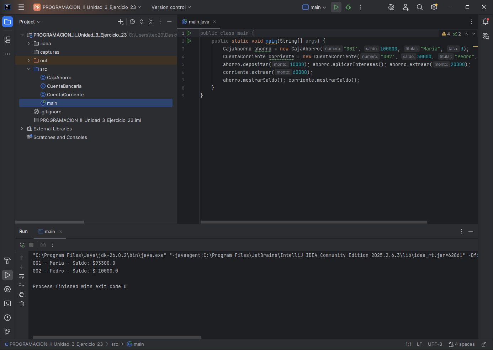

# PROGRAMACIÓN II — Unidad 3, Ejercicio 23: El Sistema de Cuentas Bancarias y Perfiles Financieros

Trabajo práctico de Programación II. Este repositorio contiene la resolución en Java del ejercicio 23 de la Unidad 3.

## Consigna

#### Contexto

Las entidades bancarias ofrecen diversas opciones de ahorro e inversión a sus clientes. Aunque todas las cuentas comparten la gestión de un número identificatorio y un saldo monetario, las cajas de ahorro generan intereses mensuales, mientras que las cuentas corrientes permiten sobregiros bajo ciertas condiciones.

#### Consigna

Modelar un sistema bancario en Java aplicando herencia para estructurar una cuenta base y sus variantes especializadas.

#### Desarrollo requerido

- Definir la clase base CuentaBancaria con atributos privados o protegidos (numeroCuenta, saldo, titular) y métodos comunes como depositar y extraer.
- Crear las clases hijas CajaAhorro (que añada un método para aplicar intereses) y CuentaCorriente (que incorpore un límite de sobregiro autorizado).
- Sobrescribir el método de extracción en la cuenta corriente para permitir extracciones que utilicen el margen de sobregiro.
- En el método main, instanciar ambos tipos de cuentas, simular operaciones financieras mixtas y mostrar los saldos finales por consola.

## Estructura del repositorio

```
PROGRAMACION_II_Unidad_3_Ejercicio_23/
├── README.md
├── capturas/
│   └── consola.png
└── src/
    ├── CajaAhorro.java
    ├── CuentaBancaria.java
    ├── CuentaCorriente.java
    └── main.java   # clase con el método main
```

## Funcionamiento y lógica

El ejercicio aplica **herencia y sobrescritura** con dos tipos de cuenta bancaria que se comportan distinto al extraer dinero.

### `CuentaBancaria` (clase base)

Tiene `numeroCuenta`, `titular` y `saldo` (`protected`), con `depositar()` (montos positivos), `extraer()` (solo hasta el saldo disponible) y `mostrarSaldo()`.

### `CajaAhorro`

Agrega una `tasaInteres`. Su método `aplicarIntereses()` suma el porcentaje al saldo, siempre que la tasa sea positiva.

### `CuentaCorriente`

Agrega un `limiteSobregiro` y sobrescribe `extraer()` (`@Override`) para permitir extraer hasta el saldo más el sobregiro.

### `main`

- **María** (caja de ahorro, $100000): deposita $10000 (queda en $110000), aplica 3 % de interés (sube a $113300) y extrae $20000. Saldo final: **$93300**.
- **Pedro** (cuenta corriente, $50000 con sobregiro de $20000): extrae $60000, lo que se permite por el sobregiro. Saldo final: **−$10000**.

## Ejecución

Captura de la consola de IntelliJ IDEA ejecutando el programa:



Salida obtenida:

```
001 - Maria - Saldo: $93300.0
002 - Pedro - Saldo: $-10000.0
```
